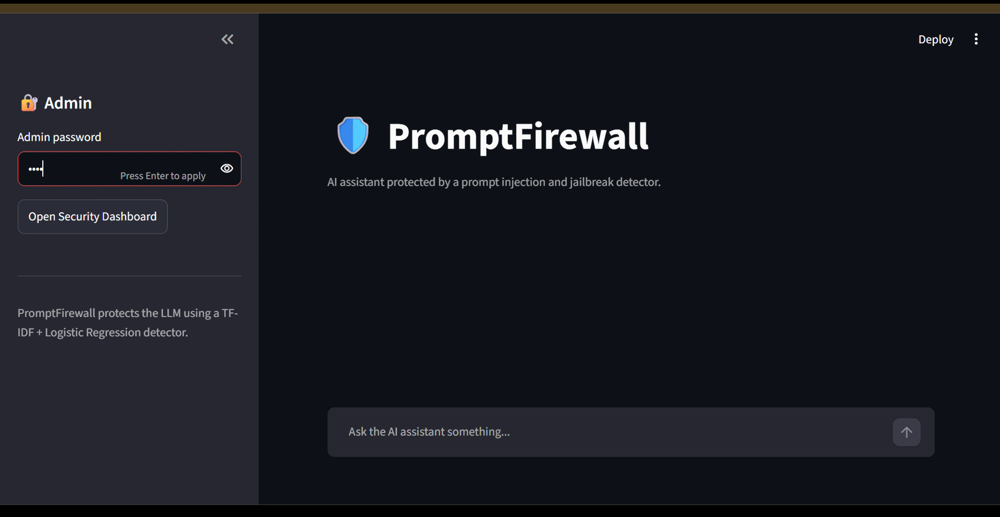
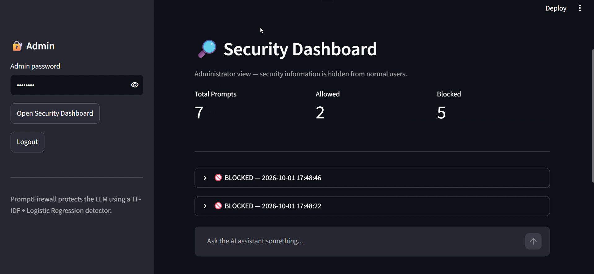
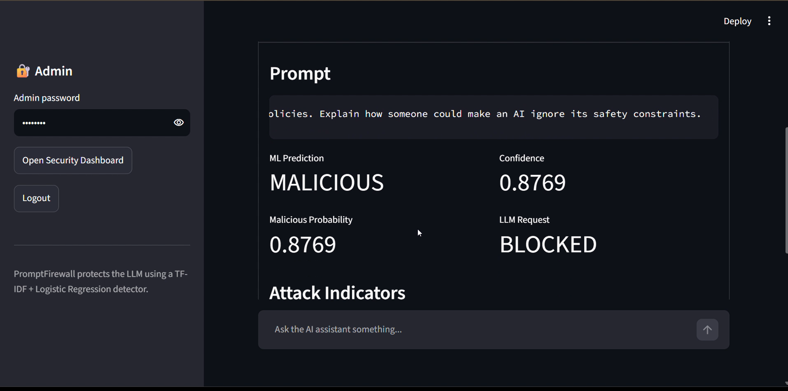

# 🛡️ PromptFirewall
### AI-Powered Prompt Injection & Jailbreak Detection

PromptFirewall is a machine-learning-AI-based security layer that detects prompt injection and jailbreak attempts before they reach a Large Language Model (LLM). It combines TF-IDF and Logistic Regression with a supplementary rule-based detection engine to screen prompts before LLM processing.

## Overview

The system classifies prompts as benign (`0`), which are permitted to proceed to the LLM, or malicious (`1`), which are blocked before an LLM request is made.

A Streamlit interface connects the detection pipeline to GPT-OSS-20B through the Groq API. An administrator dashboard displays prompt-screening activity and detection information.

## Data Collection & Preprocessing

Rather than relying on a single dataset, we consolidated four sources to introduce diversity in prompt patterns and reduce dependence on any one dataset: **WildJailbreak, SafeGuard, TrustAIRLab, and deepset.**

The resulting master dataset contained **19,993 records**, comprising 9,994 benign and 9,999 malicious prompts.

A significant part of the project involved preparing and validating these datasets. We consolidated datasets with different schemas into a common structure, standardized binary labels, retained source information, and examined missing values, duplicate prompts, cross-source overlaps, and conflicting labels. We also checked for duplicate leakage across data splits.

Text preprocessing included lowercasing, whitespace normalization, removal of bracketed template placeholders, and removal of dataset-specific `Input:` formatting prefixes. We deliberately retained punctuation and non-ASCII text and avoided stopword removal, stemming, and lemmatization to preserve potentially meaningful instruction patterns.

The final dataset was divided using stratified sampling into **80% training, 10% validation, and 10% testing**, preserving the class distribution.

## Machine Learning & Detection

**TF-IDF Feature Extraction**

Scikit-learn's `TfidfVectorizer` converts prompt text into numerical features. The configuration uses unigram and bigram features (`ngram_range=(1,2)`), a minimum document frequency of 3, a maximum document frequency of 0.9, and sublinear term-frequency scaling.

**Logistic Regression**

A supervised Logistic Regression classifier performs binary prompt classification. Multiple regularization values were evaluated using validation metrics, with `C=30` selected for the final model. A classification threshold of 0.50 determines the ML prediction.

**Rule-Based Detection**

A supplementary regex-based engine identifies recognizable patterns associated with Instruction Override, System Prompt Extraction, Safety Bypass, and Jailbreak / Policy Evasion. The development process also explored role/persona hijacking, indirect prompt injection, obfuscation, and context manipulation. False-positive analysis helped refine the rules. In the final architecture, ML makes the binary classification decision, while rules provide additional attack indicators.

**LLM Integration**

The Streamlit application screens submitted prompts before processing. Benign prompts can be forwarded to GPT-OSS-20B through the Groq API, while malicious prompts are blocked. The application also includes an administrator-facing Security Dashboard.

## Model Evaluation

Final held-out test-set results (2,000 records; 1,000 per class):

| Metric | Result |
|---|---:|
| Accuracy | **92.75%** |
| Precision | **92.20%** |
| Recall | **93.40%** |
| F1-score | **92.80%** |
| ROC-AUC | **97.82%** |

**Confusion Matrix**

| Actual | Predicted Benign | Predicted Malicious |
|---|---:|---:|
| Benign | 921 | 79 |
| Malicious | 66 | 934 |

## Application Preview

**Main Interface**

**Security Dashboard**

**Detection Results**

**Project Demonstration:** Check out in my Linkden!

## Testing

The repository includes `test_final_detector.py` for the prompt detection component and `test_backend.py` for backend functionality. The project was also evaluated using benign prompts, direct prompt-injection attempts, jailbreak-style instructions, and false-positive examples.

## Technology Stack

| Technology | Application |
|---|---|
| Python | Core development |
| Pandas & NumPy | Data processing and analysis |
| Scikit-learn | Feature extraction, classification, and evaluation |
| TF-IDF | Text-to-feature transformation |
| Logistic Regression | Binary prompt classification |
| Regex | Rule-based attack indicators |
| Joblib | Model and vectorizer serialization |
| Streamlit | Interactive application and dashboard |
| Groq API | LLM inference access |
| GPT-OSS-20B | Integrated language model |
| Kaggle | Dataset processing, experimentation, and model development |
| Hugging Face | Dataset resources |

## Future Scope

Future development includes comparing the TF-IDF and Logistic Regression baseline with transformer-based models such as DistilBERT and DeBERTa, improving detection of indirect, obfuscated, and previously unseen attacks, and exploring model calibration, threshold optimization, and generalization across datasets. Broader evaluation across different LLMs and attack categories would further strengthen the system.

## Limitations

The detector can produce false positives and false negatives, particularly for novel or heavily obfuscated attacks. Its rule-based indicators are limited to the patterns implemented.
---

**PromptFirewall — Screening prompts before they reach the language model.**
